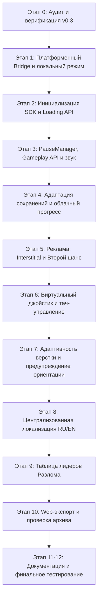

# Veymora Survivors — Аудит проекта для интеграции с платформой Яндекс Игры

## 1. Введение и цели аудита

Документ фиксирует результаты технического аудита кодовой базы **Veymora Survivors** (версия **0.3**, commit `ace0d67`) перед проведением платформенной интеграции с **Яндекс Играми**.

Цель: подготовить игру к публикации на платформе Яндекс Игры для Desktop и Mobile (Android / iOS) браузеров при сохранении 100% автономной работы игры в офлайн/локальном режиме без SDK.

---

## 2. Существующие реализации, пригодные к переиспользованию

| Подсистема | Файлы / Классы | Текущий статус и возможности для переиспользования |
|---|---|---|
| **Игровой цикл (Game Flow)** | `scripts/game/game_flow_controller.gd` `GameFlowController` (Autoload `GameFlow`) | Централизованный конечный автомат (`main_menu`, `arena_select`, `loading`, `playing`, `paused`, `results`). Идеальная точка для вызова `LoadingAPI.ready()`, `GameplayAPI.start()` и `GameplayAPI.stop()`. |
| **Система сохранений** | `scripts/game/save_manager.gd` `SaveManager` (v2) | Версионированная схема (v2), санитизация данных, сохранение в `user://save_data.json`. Поддерживает гостевой режим. Легко расширяется адаптером облачных данных `ysdk.getPlayer().setData()`. |
| **Аудиосистема** | `scripts/audio/audio_manager.gd` `AudioManager` | Процедурные звуки (без внешних зависимостей), раздельное управление `master_volume` и `sfx_volume`. Поддерживает мгновенное временное приглушение без искажения настроек игрока. |
| **Интерфейс паузы и HUD** | `scripts/ui/hud_controller.gd` `HUDController` | Управление паузой `toggle_pause()`, модальные окна улучшений и сундуков, отображение таймера, здоровья, активных заклинаний и артефактов. |
| **Экран результатов** | `scripts/ui/results_screen.gd` `ResultsScreen` | Подробная статистика забега, аналитика синергий, кнопки повтора и перехода в меню. Идеальная точка для показа Interstitial-рекламы и отправки рекордов в Leaderboard. |
| **Настройки** | `scripts/ui/settings_dialog.gd` `SettingsDialog` | Настройки звука, FX, тряски экрана, чисел урона, VSync. Готово к добавлению переключателя языка (RU / EN). |
| **Web Export конфигурация** | `export_presets.cfg` `project.godot` | Однопоточный режим (`variant/thread_support=false`), `gl_compatibility` (WebGL2), `canvas_items` + `keep`. Размер Web-сборки ~36.4 МБ (норматив платформы — до 100 МБ). |

---

## 3. Обнаруженные проблемы и риски

1. **Отсутствие разделения причин паузы (Multi-reason pause):**
   - Сейчас в `HUDController` и `MainGame` пауза переключается глобальным флагом `get_tree().paused = true/false`.
   - Риск: если игрок поставил игру на паузу, переключился на другую вкладку браузера и вернулся, событие `window.onfocus` или платформенный `resume` может принудительно снять паузу, пока игрок не готов.
   - Решение: внедрить стек/реестр причин паузы (`USER_PAUSE`, `BROWSER_FOCUS`, `PLATFORM_PAUSE`, `ADVERTISEMENT`, `OTHER`). Пауза снимается только тогда, когда все блокирующие причины устранены.

2. **Отсутствие сенсорного управления для мобильных устройств:**
   - В `PlayerController.get_input_direction()` считываются только клавиши клавиатуры (WASD и стрелки).
   - На смартфонах и планшетах перемещение мага невозможно.
   - Решение: разработать компонент виртуального аналогового джойстика (`VirtualJoystick`), который активируется на мобильных устройствах или тач-экранах.

3. **Браузерные жесты и конфликты на мобильных устройствах:**
   - Стандартный HTML-шаблон Godot не блокирует long-tap контекстное меню, выделение текста и pull-to-refresh на мобильных браузерах.
   - Решение: кастомный `index.html` с CSS-свойствами `touch-action: none`, `user-select: none`, `-webkit-touch-callout: none` и обработчиками `contextmenu`.

4. **Жёстко зашитые текстовые строки (Hardcoded Russian strings):**
   - Все названия, описания способностей, артефактов, синергий, экранов меню и подсказок написаны исключительно на русском языке в исходниках GDScript и сценах TSCN.
   - Требование Яндекс Игр: поддержка минимум двух языков (RU и EN), с автоопределением языка через `ysdk.environment.i18n.lang`.
   - Решение: централизованная система локализации (`LocalizationManager`) с поддержкой ключей и переключением на лету.

5. **Прямое взаимодействие с JavaScript SDK:**
   - В Godot прямое обращение к `JavaScriptBridge` в коде геймплея создаёт утечки платформенного кода и ломает десктопный / редакторный запуск.
   - Решение: изолированный `YandexGamesBridge` (Autoload `YandexBridge`), инкапсулирующий все вызовы SDK и предоставляющий безопасный fallback при отсутствии JS.

6. **Преждевременный вызов LoadingAPI.ready():**
   - Если вызвать `ysdk.features.LoadingAPI.ready()` на старте скрипта HTML, платформа зафиксирует готовность до инициализации сцен Godot и загрузки ресурсов.
   - Решение: вызывать `ready()` только после полной загрузки стартового интерфейса (`MainMenu._ready()`).

---

## 4. Недостающие компоненты

1. **`YandexGamesBridge` (`scripts/platform/yandex_games_bridge.gd`):**
   - Изолированный фасад над `JavaScriptBridge` и Яндекс SDK.
   - Инициализация SDK, обработка таймаутов, проверка авторизации, получение данных игрока, отправка `GameplayAPI.start()` / `stop()`, вызовы Interstitial и Rewarded рекламы, работа с Leaderboard.

2. **`PauseManager` (`scripts/game/pause_manager.gd`):**
   - Управление паузой на основе набора активных причин.
   - Управление временным приглушением звука без изменения настроек громкости пользователя.

3. **`LocalizationManager` (`scripts/game/localization_manager.gd`):**
   - Словарь переводов (RU / EN) для всех игровых текстов: меню, арены, артефакты, синергии, эволюции, атлас, подсказки, настройки, реклама, ошибки.
   - Интеграция с `ysdk.environment.i18n.lang` и опцией в `SettingsDialog`.

4. **`VirtualJoystick` (`scripts/ui/virtual_joystick.gd` & `scenes/ui/virtual_joystick.tscn`):**
   - Визуальный сенсорный джойстик с плавающим или фиксированным центром, динамическим радиусом и поддержкой мультитача.
   - Кнопка паузы в верхнем правом углу для мобильного интерфейса.

5. **Механика «Второй шанс» (Second Chance Rewarded Ad):**
   - Окно предложения воскрешения при гибели мага (один раз за забег).
   - Выдача возрождения строго по колбэку `onRewarded`.

6. **Таблица лидеров «Лучшие исследователи Разлома»:**
   - Расчёт счёта забега ($S = \text{Time} \times 10 + \text{Kills} \times 5 + \text{Elites} \times 50 + \text{Boss} \times 500$).
   - Отправка рекорда в Yandex Leaderboards через Bridge при наличии авторизации / гостевого режима.

7. **Адаптивный Web Export шаблон (`build/web/index.html`):**
   - Подключение SDK Яндекс Игр (`https://yandex.ru/games/sdk/v2`).
   - Настройка мобильных meta-тегов, блокировка системных жестов, адаптация canvas под размеры контейнера iframe.

---

## 5. План платформенной интеграции

---

## 6. Затрагиваемые файлы и классы

### Новые файлы:
- `scripts/platform/yandex_games_bridge.gd` — платформенный мост над SDK Яндекс Игр.
- `scripts/game/pause_manager.gd` — многофакторный менеджер паузы.
- `scripts/game/localization_manager.gd` — менеджер локализации RU/EN.
- `scripts/ui/virtual_joystick.gd` — сенсорный виртуальный джойстик.
- `scenes/ui/virtual_joystick.tscn` — сцена тач-управления.
- `scripts/ui/second_chance_dialog.gd` — окно предложения Rewarded-рекламы при гибели.
- `scenes/ui/second_chance_dialog.tscn` — модальное окно «Второго шанса».
- `scenes/ui/orientation_warning.tscn` — баннер с просьбой повернуть мобильное устройство в альбомный режим.
- `tests/test_yandex_integration.gd` — комплексный автоматический тест всех компонентов интеграции.
- `docs/YANDEX_GAMES_AUDIT.md` — данный документ аудита.
- `docs/YANDEX_GAMES_RELEASE_CHECKLIST.md` — чеклист консоли разработчика.
- `docs/YANDEX_GAMES_INTEGRATION_REPORT.md` — итоговый отчет.

### Модифицируемые существующие файлы:
- `project.godot` — регистрация Autoload (`YandexBridge`, `PauseMgr`, `LocMgr`).
- `scripts/game/game_flow_controller.gd` — отправка `GameplayAPI.start()` / `stop()` и синхронизация состояний.
- `scripts/game/save_manager.gd` — интеграция облачных данных и объединение профилей.
- `scripts/player/player_controller.gd` — опрос виртуального джойстика наряду с клавишами.
- `scripts/ui/hud_controller.gd` — перенос паузы на `PauseMgr`, мобильная кнопка паузы, интеграция «Второго шанса».
- `scripts/ui/main_menu.gd` — вызов `LoadingAPI.ready()`, авторизация, кнопка таблицы лидеров.
- `scripts/ui/results_screen.gd` — вызов Interstitial рекламы при переходах, отправка рекорда в Leaderboard.
- `scripts/ui/settings_dialog.gd` — выбор языка (Русский / English).
- `scripts/audio/audio_manager.gd` — хуки приглушения звука через `PauseMgr`.
- `build/web/index.html` — подключение SDK Яндекс Игр, адаптивные стили.

